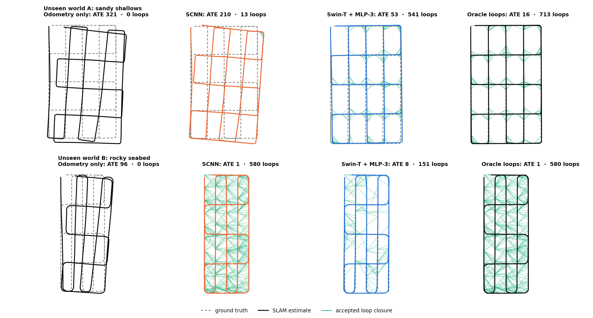
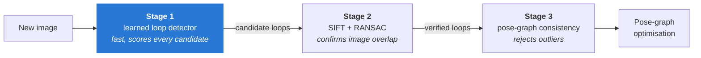
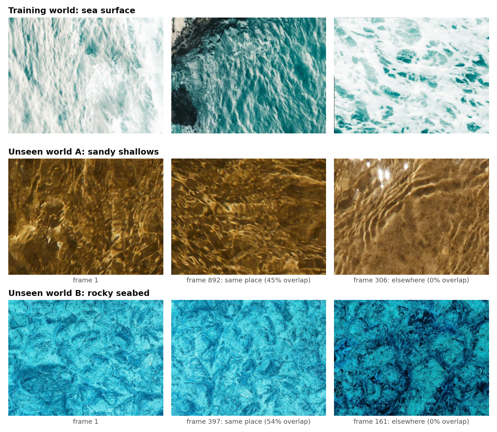
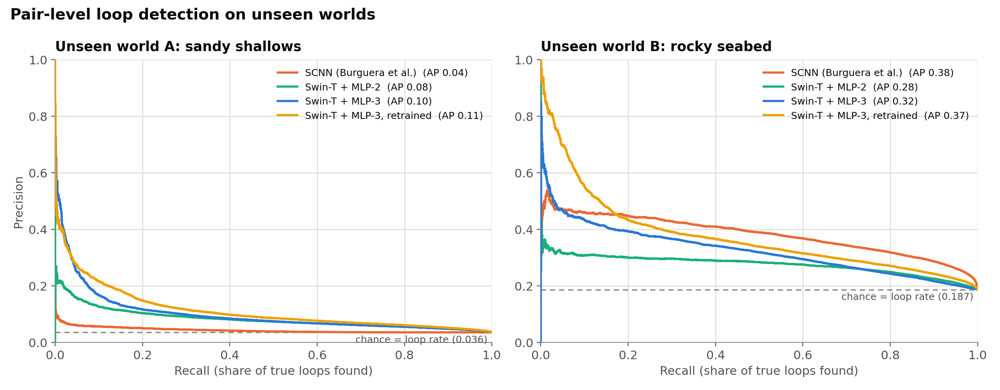

<div align="center">

# Learned Loop Detection for Underwater Visual SLAM

**Swin Transformer vs. Siamese CNN as the first stage of an outlier-resilient underwater graph-SLAM pipeline, evaluated end to end on two unseen seafloors.**

[](https://github.com/svillhauer/swin-underwater-loop-closure/actions/workflows/ci.yml)




<sub>Graph SLAM on two seafloors that no model was trained on, with the stage-1 loop detector as the only variable. Dashed: ground truth. Green: accepted loop closures. ATE: absolute trajectory error (lower is better).</sub>

</div>

---

## TL;DR

- **Swin-T is the more robust stage-1 detector across terrains.** A frozen, ImageNet-pretrained Swin-T with a small trained head ranks loops consistently on both unseen worlds (ROC-AUC 0.66–0.74). The original Siamese CNN swings from near-chance on sandy shallows (0.53) to the best result on a rocky seabed (0.77).
- **The geometric stages make a permissive stage 1 safe.** Across all 6 detector runs on both worlds, **not one false loop reached the pose graph**: RANSAC rejected every false candidate.
- **So map quality tracks stage-1 recall, and the cost shows up as RANSAC time.** On sand, Swin-T cuts the trajectory error **4× versus the SCNN** (ATE 210 → 53). On rock, the SCNN flags almost everything and matches the oracle (ATE 1.3), at oracle-level RANSAC cost.
- **Everything is reproducible:** a PyTorch port of the original SCNN verified to 7×10⁻⁷ against Keras, the original SLAM back end used unmodified, 17 unit tests, and CI.

## The problem

An AUV mapping the seafloor without GPS accumulates drift. It corrects that drift by recognising places it has been before (**loop closure**). Underwater this is hard: low light, haze and repetitive sand or caustic textures make two views of the same spot look different, and two different spots look alike. A single false loop in the pose graph can bend the entire map.

[Burguera et al. (2022)](https://doi.org/10.3390/jmse10040511) handle this with a three-stage filter:



Stage 1 decides which of the thousands of past images are worth the expensive geometric checks. The original system uses a Siamese CNN (SCNN). **This project replaces it with a frozen Swin Transformer (Swin-T) plus a small trained classifier**, and measures what that changes, both per image pair and in the final map.

## Data

<p align="center"></p>

Datasets come from [UCAMGEN](https://github.com/aburguera/UCAMGEN): a virtual bottom-looking camera moves over a large "world" photo with 2.5 degrees of freedom, recording images, ground-truth poses and pairwise overlap. A pair counts as a **loop** if the images overlap at all. On the low-feature worlds, two views of the same place often look no more alike than views of different places, as the examples above show.

| World | Role | Images | Pairs | Loops | Download |
|---|---|:-:|:-:|:-:|---|
| Sea surface | training | 1,125 | 632,250 | 2.6% | `ucamgen_sea_train.zip` |
| High-feature reef (UCAMGEN's sample world) | head validation (`train_head.py`) | 599 | 179,101 | – | generate with UCAMGEN's sample world |
| **A: sandy shallows** | **unseen test** | 892 | 397,386 | 3.6% | `ucamgen_sand_test.zip` |
| **B: rocky seabed** | **unseen test** | 397 | 78,606 | 18.7% | `ucamgen_rocky_test.zip` |

The downloads are attached to the [v0.1.0 release](https://github.com/svillhauer/swin-underwater-loop-closure/releases/tag/v0.1.0). The world images for these datasets are photos from [Pexels](https://www.pexels.com/search/underwater/).

## Results

### 1. Pair-level loop detection

<p align="center"></p>

| Stage-1 detector | A: sand ROC-AUC | A: sand avg. precision | B: rock ROC-AUC | B: rock avg. precision |
|---|:-:|:-:|:-:|:-:|
| SCNN (Burguera et al.) | 0.533 | 0.044 | **0.769** | **0.382** |
| Swin-T + MLP-2 | 0.712 | 0.084 | 0.662 | 0.276 |
| Swin-T + MLP-3 | 0.713 | 0.101 | 0.679 | 0.325 |
| Swin-T + MLP-3, retrained | **0.743** | **0.114** | 0.717 | 0.374 |
| *Chance* | *0.500* | *0.036* | *0.500* | *0.187* |

<sub>Every detector scores <b>every</b> image pair of each world. Average precision (area under the precision-recall curve) is the headline metric because loops are rare: a model that never predicts "loop" scores 96% accuracy on world A.</sub>

- **Generalization depends on the terrain.** The SCNN is near chance on sand and is the strongest ranker on rock. Swin-T embeddings, never trained on underwater imagery, stay consistently above chance on both.
- **The retrained head is the best Swin-T variant on both worlds.** I trained it with class-balanced sampling and validated it on a *third* world instead of on random pairs of its training world, and it improves average precision by 13–15% over the original 3-layer head.
- **Stage 1 alone is not a reliable classifier on unseen terrain.** That's why the downstream geometric stages exist.

### 2. End-to-end SLAM

The detectors run inside the full pipeline. Odometry noise, loop-motion noise and candidate selection are identical across runs; only stage 1 changes.

**World A: sandy shallows** (892 frames, 78,765 candidates checked, 1,962 true loops)

| Stage-1 detector | Proposed (true / false) | After RANSAC (true / false) | Loops in graph | ATE ↓ | RANSAC time |
|---|:-:|:-:|:-:|:-:|:-:|
| None (odometry only) | – | – | 0 | 321 | – |
| SCNN | 45 / 1,204 | 35 / 0 | 13 | 210 | 14 s |
| Swin-T + MLP-2 | 12 / 66 | 11 / 0 | 0 | 321 | 3 s |
| **Swin-T + MLP-3** | **1,316 / 29,207** | **1,004 / 0** | **541** | **53** | 366 s |
| *Oracle (every true loop)* | *1,962 / 0* | *1,451 / 0* | *713* | *16* | *187 s* |

**World B: rocky seabed** (397 frames, 15,405 candidates checked, 2,558 true loops)

| Stage-1 detector | Proposed (true / false) | After RANSAC (true / false) | Loops in graph | ATE ↓ | RANSAC time |
|---|:-:|:-:|:-:|:-:|:-:|
| None (odometry only) | – | – | 0 | 95.7 | – |
| **SCNN** | **2,544 / 10,458** | **1,621 / 0** | **580** | **1.3** | 209 s |
| Swin-T + MLP-2 | 915 / 3,032 | 575 / 0 | 303 | 10.1 | 76 s |
| Swin-T + MLP-3 | 363 / 578 | 237 / 0 | 151 | 7.8 | 32 s |
| *Oracle (every true loop)* | *2,558 / 0* | *1,627 / 0* | *580* | *1.3* | *179 s* |

<sub>ATE in world-image pixels, mean over the trajectory. All detectors use their default 0.5 threshold. Stage-1 scoring itself takes about 1 s per run for all candidates.</sub>

- **Zero false loops entered the graph in any run.** RANSAC rejected every false candidate, from 66 up to 29,207 of them, so stage 1 can afford to be permissive.
- **ATE follows how many true loops stage 1 lets through.** On sand, Swin-T + MLP-3 closes 541 loops and gets 88% of the way from odometry-only to the oracle; the SCNN closes 13. On rock, the SCNN proposes 84% of all candidates, RANSAC filters them, and the map equals the oracle's.
- **The real trade-off is RANSAC time.** A permissive stage 1 costs geometric verification; a strict one costs map accuracy. Swin-T + MLP-3 lands at 7.8 ATE on rock in 32 s of RANSAC, against 1.3 in 209 s for the SCNN.
- **One fixed threshold is not enough.** At 0.5, Swin-T + MLP-2 never collects the 5 mutually consistent loops the pose filter needs on sand, yet it works on rock. The decision threshold has to adapt to the terrain.

## How it works

| Component | Details |
|---|---|
| **Swin-T embedder** | `microsoft/swin-tiny-patch4-window7-224` ([Liu et al., 2021](https://arxiv.org/abs/2103.14030)), frozen. Images resized to 224×224 and ImageNet-normalised; 768-d pooled descriptor per image. |
| **Loop classifier** | MLP on the concatenated descriptors of an image pair. MLP-2: 1536→512→1. MLP-3: 1536→512→256→1. Trained with binary cross-entropy. |
| **Efficient scoring** | Both detectors are Siamese, so each image is embedded once and pairs are scored from cached features: all 397k pairs of world A in about 6 s on a laptop GPU. |
| **SCNN baseline** | The original Keras SCNN ([Burguera, 2021](https://github.com/aburguera/SNNLOOP)), **ported to PyTorch** and loaded directly from the original `.h5` weights. Verified against Keras to a maximum difference of 6.6×10⁻⁷, including TensorFlow's asymmetric "same" padding and channels-last flattening. No TensorFlow needed. |
| **SLAM back end** | The original [GSLAM](https://github.com/aburguera/GSLAM) code, **unmodified**, as a git submodule. Two library API changes (OpenCV SIFT, NumPy 2) are shimmed at runtime, and an `ImageMatcher` subclass caches SIFT features and handles featureless images gracefully. |

<details>
<summary><b>Evaluation protocol, and what changed from earlier versions of this experiment</b></summary>

&nbsp;

Re-implementing the experiment uncovered several issues in the earlier evaluation that overstated the gap between the detectors. They are fixed here:

- **Same pairs for every model.** Earlier SCNN and Swin-T numbers came from different test sets, a balanced 4,444-pair subset and all 78,606 pairs of world B, so their accuracies weren't comparable. Here every detector scores every pair of each world.
- **Threshold-free metrics.** With 3.6–18.7% positives, accuracy rewards predicting "no loop". ROC-AUC and average precision are reported instead.
- **World-level splits.** Splitting *pairs* at random puts the same image in train and test, which inflated validation accuracy to about 99%. `train_head.py` validates on separate worlds.
- **Aligned SLAM candidates.** An earlier SLAM script sliced candidate IDs and candidate images differently, so after 50 frames each image was compared against the wrong candidates. `run_slam.py` keeps them aligned and seeds RANSAC per pair, so every detector sees identical noise.

</details>

## Quickstart

```bash
git clone --recurse-submodules https://github.com/svillhauer/swin-underwater-loop-closure.git
cd swin-underwater-loop-closure
pip install -e ".[swin,slam,dev]"

# Weights and datasets (GitHub release v0.1.0)
gh release download v0.1.0 --pattern "*.pth" --pattern "*.h5" --pattern "*.json" --dir weights
gh release download v0.1.0 --pattern "*.zip" --dir data && (cd data && for z in *.zip; do unzip -q "$z"; done)
(cd data && ln -s ucamgen_sea_train train_sea && ln -s ucamgen_sand_test test_sand && ln -s ucamgen_rocky_test test_rocky)

# 1. Pair-level benchmark on an unseen world
python scripts/benchmark.py --test data/test_sand --scnn weights/scnn_sea.h5 \
    --swin-head "Swin-T + MLP-3=weights/swin_mlp3.pth:mlp3" --out results/benchmark_sand.json

# 2. End-to-end SLAM with a chosen stage-1 detector
python scripts/run_slam.py --data data/test_sand --detector swin \
    --swin-head weights/swin_mlp3.pth --variant mlp3 --out results/slam_sand
python scripts/run_slam.py --data data/test_sand --detector scnn --scnn weights/scnn_sea.h5 --out results/slam_sand

# 3. Figures
python scripts/plot_results.py
```

Train a new head on frozen Swin-T embeddings (seconds per epoch):

```bash
python scripts/train_head.py --train data/train_sea --val data/val_high_feature --variant mlp3 \
    --out weights/my_head.pth
```

## Repository layout

```text
swin-underwater-loop-closure/
├── src/loopclosure/
│   ├── swin.py          # frozen Swin-T image embedder
│   ├── heads.py         # MLP loop classifiers (+ loader for the original checkpoints)
│   ├── scnn.py          # PyTorch port of the Siamese CNN, loads the original Keras .h5
│   ├── detectors.py     # common interface: embed each image once, score any set of pairs
│   ├── ucamgen.py       # UCAMGEN dataset reader and loop labels
│   ├── metrics.py       # ROC-AUC, average precision, PR curve, best F1 (NumPy)
│   └── gslam.py         # adapter for the unmodified GSLAM back end
├── scripts/
│   ├── benchmark.py     # pair-level evaluation  -> results/benchmark_*.json
│   ├── run_slam.py      # 3-stage SLAM with a chosen detector -> results/slam_*/
│   ├── train_head.py    # train a loop head with world-level validation
│   └── plot_results.py  # README figures
├── third_party/GSLAM/   # git submodule (Burguera et al.)
├── results/             # metrics and trajectories behind every number in this README
├── tests/               # 17 unit tests
└── docs/media/
```

## Testing

```bash
pytest       # CPU-only, no datasets or weights needed
ruff check .
```

The tests pin down the details that are easy to get silently wrong:

- the SCNN port's convolution must match a direct NumPy implementation of TensorFlow's "same" padding;
- ROC-AUC must match the brute-force pairwise definition, and random scores must give an average precision equal to the base rate;
- datasets prepared for GSLAM must load in GSLAM's own `DataSimulator`;
- the RANSAC verifier must fail cleanly on featureless images.

CI runs the tests on Python 3.10 and 3.12, with the GSLAM submodule checked out.

## Limitations & next steps

- **Synthetic data.** UCAMGEN views are crops of a static photo with 2.5 degrees of freedom: no roll or pitch, no lighting change, no backscatter, no moving life. Validating on real AUV imagery with ground-truth poses is the most important next step.
- **Terrain-dependent calibration.** Neither detector's 0.5 threshold, nor a threshold tuned on another world, transfers. A per-frame top-k candidate budget, or self-calibration from each mission's odometry, would make stage 1 a recall-versus-time knob instead of a fixed cutoff.
- **The backbone is frozen and ImageNet-trained.** Fine-tuning on underwater imagery, or contrastive place-recognition training, is the obvious next gain. So is combining the two detectors, given how differently they fail.
- **RANSAC load.** Feeding the detector's confidence into candidate ordering, or into pose-graph edge weights, would cut geometric verification time without losing loops.

## Credits & references

The SLAM pipeline, dataset generator and SCNN baseline are the work of Antoni Burguera and colleagues. This repository contributes the Swin-T loop detector, the PyTorch SCNN port, the evaluation and SLAM-integration code, and the experiments.

- A. Burguera, F. Bonin-Font, E. Guerrero Font and A. Martorell Torres. **Combining Deep Learning and Robust Estimation for Outlier-Resilient Underwater Visual Graph SLAM.** *Journal of Marine Science and Engineering*, 10(4):511, 2022. [doi:10.3390/jmse10040511](https://doi.org/10.3390/jmse10040511)
- A. Burguera. **Lightweight Underwater Visual Loop Detection and Classification using a Siamese Convolutional Neural Network.** 13th IFAC Conference on Control Applications in Marine Systems, Robotics, and Vehicles (CAMS), 2021.
- Code: [GSLAM](https://github.com/aburguera/GSLAM), [SNNLOOP](https://github.com/aburguera/SNNLOOP) and [UCAMGEN](https://github.com/aburguera/UCAMGEN) by Antoni Burguera.
- Z. Liu et al. **Swin Transformer: Hierarchical Vision Transformer using Shifted Windows.** ICCV 2021. [arXiv:2103.14030](https://arxiv.org/abs/2103.14030)
- Pose-graph optimisation: [python-graphslam](https://github.com/JeffLIrion/python-graphslam) by Jeff Irion.

## License

The code in this repository is released under the [MIT License](LICENSE). The `third_party/GSLAM` submodule and the original SCNN weights remain the work of their authors and are not covered by this license.
